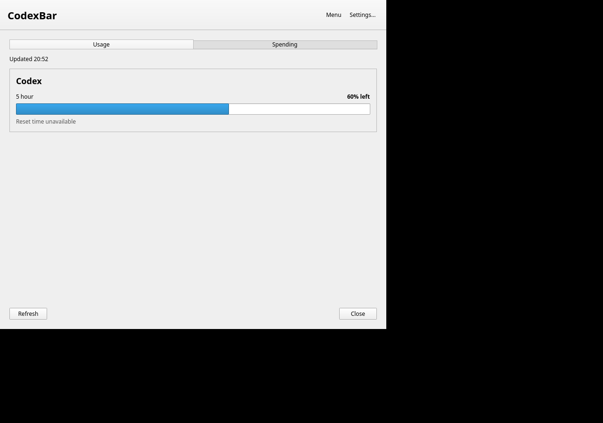

# Linux desktop entry escaping proof

Verified on Linux x86_64 with Python 3.13.5 and GIO 2.84.4.
Baseline: `eb7d060e4d932883737ee79fbb7dd4bd817ecba0`.

## Cause and coverage

The installer escaped command arguments, but omitted the desktop entry string
escaping applied before command parsing. Dollar signs, backticks, and double
quotes in the home directory made installed launcher and autostart entries fail
to launch. The repair doubles the argument's backslashes for the outer string
layer, as required by the [Desktop Entry specification](https://specifications.freedesktop.org/desktop-entry/latest/exec-variables.html).

Review also reproduced a percent-path failure: GIO rejects `%%f` in the
executable token before expanding it. Paths containing `%` now use
`/bin/sh` as the executable with the constant program `exec "$@"`; the escaped
installed path and flags are passed as separate arguments, never as shell code.
This also handles `%` and `=` together: `env` would treat that path as an
assignment instead of a command. Other paths still launch the binary directly.

The serialization regression runs the actual installer with synthetic homes and
checks all four generated Exec commands: usage, settings, spending, and autostart.
It covers spaces, dollar signs, backticks, double quotes, backslashes, and the
percent-path command prefix.

The runtime regression installs a recording executable into a synthetic home
containing spaces, dollar signs, a backtick, a double quote, and a backslash,
then repeats with `%f` and `%f=` added. GIO launches both generated desktop entries for
each home. The test checks the executable's receipt
for its exact installed path and the expected `--usage` or `--background` argument.
Receipts are renamed into place after writing to avoid partial reads.

The runtime test is skipped when `gio` is unavailable. It ran without skipping
on the verification host. All test files and installations use temporary
directories; no provider credentials or real application processes are involved.

## Before

Both new tests were run against a temporary copy of the unmodified baseline
installer, using the current test file and the repository icon:

```text
test_desktop_commands_escape_special_characters_in_the_home_path
  FAIL: has$cash
  FAIL: has`tick
  FAIL: has"quote
  FAIL: has\slash
  FAIL: has%f and has%f=path
test_desktop_entries_launch_the_installed_binary_with_special_home_characters
  FAIL: --usage and --background, home without %f
  FAIL: --usage and --background, home with %f
  FAIL: --usage and --background, home with %f=
  gio: Desktop file didn't specify Exec field

Ran 2 tests
FAILED (failures=12)
```

Reproduce from this PR checkout in Bash without changing the working tree:

```bash
(
proof_root=$(mktemp -d)
trap 'rm -rf "$proof_root"' EXIT
mkdir -p "$proof_root/Integrations/Linux" "$proof_root/Integrations/Omarchy"
git show eb7d060e4d932883737ee79fbb7dd4bd817ecba0:Integrations/Linux/install.py > "$proof_root/Integrations/Linux/install.py"
cp Integrations/Linux/icon.svg "$proof_root/Integrations/Linux/"
cp Integrations/Omarchy/test_install.py "$proof_root/Integrations/Omarchy/"
python3 "$proof_root/Integrations/Omarchy/test_install.py" \
  InstallTests.test_desktop_commands_escape_special_characters_in_the_home_path \
  InstallTests.test_desktop_entries_launch_the_installed_binary_with_special_home_characters
)
```

## After

```text
$ python3 -m unittest -v Integrations.Omarchy.test_install Integrations.Linux.tests.test_package
Ran 13 tests in 7.099s
OK

$ node --test Integrations/Omarchy/test.mjs Integrations/Omarchy/notifications.test.mjs
tests 94
pass 94
fail 0
skipped 0

$ git diff --check
exit 0
```

The percent-path review regression was also run against the initial PR commit
`d9c8688429223e104d1344f3b5d9fea2f74bed7a` before the follow-up fix. The two new
tests reported six failures: both percent serialization subcases and four GIO
launches under the homes containing `%f` and `%f=`. GIO reported `Unable to load
application information`. The same tests now pass with the constant shell
forwarder. A rejected local `env` version separately failed to record both
`%f=` invocations; the final forwarder fixes that case too.

## Actual installed application and release upgrade

The official `CodexBarDesktop-v0.79.0-linux-x86_64.tar.gz` was downloaded with its
release checksum, verified, and extracted. SHA-256:
`44dcb2e2bd1669db3a89c2dc424df23d2db35f21828a810213edb71684bbd45c`.

[The executable proof script](linux-desktop-release-upgrade.py) installs that real
Qt application into a temporary home containing `%f=`, spaces, `$`, a backtick,
a double quote, and a backslash. It first uses the released installer, reproduces
the broken desktop entry, and starts the installed app directly to show existing
settings load. It then reruns the modified installer, preserves the saved JSON
and backup, and verifies `Hidden=true` remains set.

After the upgrade, GIO launches the actual installed app from both desktop
entries. Private IPC returns the expected fixture usage, `/proc/<pid>/exe`
identifies the installed binary, and X11 contains the Usage & Spend window.
The test checks existing settings again after each launch. The provider CLI is
synthetic; the desktop application is the actual official release executable.

[Captured output](linux-desktop-release-upgrade.txt):

```text
Official release: codexbar-linux 0.79.0
v0.79.0 launcher before upgrade: FAIL as expected, GIO rejected Exec
v0.79.0 installed app loads existing preferences: PASS, CX 60%
Upgrade: existing preferences, backup, and disabled autostart preserved: PASS
After upgrade, GIO launcher: PASS, actual installed Qt app, IPC CX 60%
Actual Usage & Spend window on Xvfb display: PASS
After upgrade, GIO autostart: PASS, actual installed Qt app, IPC CX 60%
Final preferences unchanged and Hidden=true: PASS
```



Reproduce with the documented desktop runtime packages, GIO, Xvfb, `xwininfo`,
and ImageMagick `import` already installed:

```bash
release_dir=$(mktemp -d)
gh release download v0.79.0 --repo steipete/CodexBar \
  --pattern 'CodexBarDesktop-v0.79.0-linux-x86_64.tar.gz*' --dir "$release_dir"
(cd "$release_dir" && sha256sum -c CodexBarDesktop-v0.79.0-linux-x86_64.tar.gz.sha256 && tar -xzf CodexBarDesktop-v0.79.0-linux-x86_64.tar.gz)
xvfb-run -a -s '-screen 0 1280x900x24' python3 \
  .github/pr-proof/linux-desktop-release-upgrade.py \
  "$release_dir/CodexBarDesktop-v0.79.0-linux-x86_64" /tmp/codexbar-upgrade.png
```

This proves desktop-entry execution and v0.79.0 preference compatibility on
Linux x86_64 under Xvfb. It does not simulate a desktop login or access live
provider accounts. Autostart is invoked through GIO without enabling it.

## Repository check limitation

`nice -n 10 make check` passed the initial localization checks, then stopped in
the pre-existing CLI installer regression on this Linux host:

```text
AssertionError: The installer regression test requires macOS AppleScript.
make: *** [Makefile:26: check] Error 1
```

The complete repository check is not claimed as passing. No Swift sources changed;
no Swift build or full Swift suite was run on the Intel N95.
